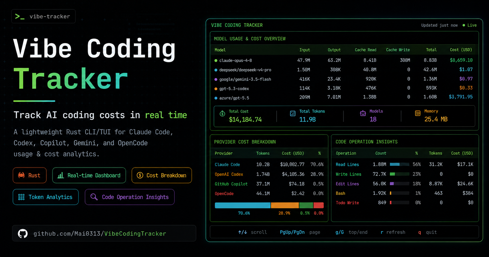

<div align="center" markdown="1">

# Vibe Coding Tracker — AI 编程助手使用量追踪器

[](https://crates.io/crates/vct-cli) [](https://crates.io/crates/vct-cli) [](https://www.npmjs.com/package/vibe-coding-tracker) [](https://www.npmjs.com/package/vibe-coding-tracker) [](https://pypi.org/project/vibe_coding_tracker/) [](https://pypi.org/project/vibe-coding-tracker) [](https://www.rust-lang.org/) [](https://github.com/Mai0313/VibeCodingTracker/actions/workflows/test.yml) [](https://github.com/Mai0313/VibeCodingTracker/actions/workflows/code-quality-check.yml) [](https://github.com/Mai0313/VibeCodingTracker/tree/main?tab=License-1-ov-file) [](https://github.com/Mai0313/VibeCodingTracker) [](https://github.com/Mai0313/VibeCodingTracker/pulls)



</div>

**实时追踪你的 AI 编程开销。** Vibe Coding Tracker 是一款基于 Rust 构建的轻量级高性能 CLI 工具，用于监控和分析你在 Claude Code、Codex、Copilot、Gemini、OpenCode、Cursor、Hermes、Grok、DeepSeek Harness 和 Antigravity 上的使用情况——提供详细的费用明细、token 统计和代码操作洞察，同时保持极低的内存占用。

[English](README.md) | [繁體中文](README.zh-TW.md) | [简体中文](README.zh-CN.md)

> 注意：CLI 示例中使用简写别名 `vct`。如果你是通过 npm/pip/cargo 安装的，二进制文件可能命名为 `vibe_coding_tracker` 或 `vct`。如有需要，请创建别名或在运行命令时将 `vct` 替换为完整名称。

---

## 为什么选择 Vibe Coding Tracker？

### 掌握你的开销

不用再猜测 AI 编程会话到底花了多少钱。通过 [LiteLLM](https://github.com/BerriAI/litellm) 自动更新定价，获取**实时费用追踪**。

### 超轻量级

使用 Rust 构建, 资源占用极低. 交互式 TUI 面板完成首次刷新后, 常驻内存通常在 **60 MB 左右**, 即使磁盘上有数千个 session 文件也不例外. `~/.vct/sessions/` 下的 session 账本让每次运行都只需重新解析新增或变更的 source.

### 精美的可视化

选择你喜欢的查看方式：

- **交互式面板**: 一个终端 app, 包含 Usage, Analysis, Quota 与 Settings 四个标签页, 可立即显示 loading spinner, 支持后台 incremental refresh, 可滚动并可排序的模型列表 (方向键), 进程级 CPU/内存实时读数, 以及 K/M/B 精简数字格式
- **静态报表**：专业的表格，适合文档记录
- **脚本友好**：纯文本和 JSON 格式，方便自动化
- **完整精度**：导出精确费用，满足财务核算需求

### 零配置

自动检测并处理来自 Claude Code、Codex、Copilot、Gemini、OpenCode、Cursor、Hermes、Grok、DeepSeek Harness 和 Antigravity 的日志。无需任何设置——直接运行即可分析。首次运行时会自动生成一个带有合理默认值的 `~/.vct/config.toml`，方便你日后想调整行为时使用（参见 [配置](#%E9%85%8D%E7%BD%AE)）。

### 丰富的洞察

- 按模型和日期统计 token 使用量
- 按 cache 类型（读取/创建）细分费用
- 文件操作追踪（编辑、读取、写入行数）
- 工具调用历史（Bash、Edit、Read、Write、TodoWrite）
- 按供应商统计总计

---

## 核心特性

| 特性             | 说明                                                                                                 |
| ---------------- | ---------------------------------------------------------------------------------------------------- |
| **多供应商支持** | Claude Code、Codex、Copilot、Gemini、OpenCode、Cursor、Hermes、Grok、DeepSeek Harness 和 Antigravity |
| **智能定价**     | 模糊模型匹配 + 从 LiteLLM 每日缓存更新                                                               |
| **4 种显示模式** | 交互式 TUI、静态表格、纯文本和 JSON                                                                  |
| **双维度分析**   | token/费用统计（`usage`）+ 代码操作统计（`analysis`）                                                |
| **实时额度面板** | Claude、Codex、Copilot、Cursor、Grok 和 Antigravity 的实时额度用量                                   |
| **超轻量级**     | TUI 常驻内存约 60 MB、精简的 incremental scan, 基于 Rust 构建                                        |
| **实时更新**     | 响应式 loading 与后台 refresh, 并高亮变化                                                            |

---

## 快速开始

### 安装

选择最适合你的安装方式：

#### 方式一：通过 npm 安装

**前置条件**：[Node.js](https://nodejs.org/) v22 或更高版本

以下包名任选其一（内容完全相同）：

```bash
# Main package
npm install -g vibe-coding-tracker

# Short alias with scope
npm install -g @mai0313/vct

# Full name with scope
npm install -g @mai0313/vibe-coding-tracker
```

#### 方式二：通过 PyPI 安装

**前置条件**：Python 3.8 或更高版本

```bash
pip install vibe_coding_tracker
# Or with uv
uv pip install vibe_coding_tracker

# Run without installing, straight from PyPI (uv)
uvx vibe_coding_tracker usage
```

#### 方式三：通过 crates.io 安装

使用 Cargo 从 Rust 官方包注册中心安装：

```bash
cargo install vct-cli
```

### 首次运行

```bash
# Open the interactive app on the Usage tab
vct

# Or run the binary built by Cargo/pip
vibe_coding_tracker

# Open it on the Analysis tab (code operations across all sessions)
vct analysis
```

---

## 命令指南

运行 `vct --help` 可列出所有命令，`vct <command> --help` 则会列出该命令的 flag。

不带任何命令运行 `vct` 会打开交互式界面，一个画面有四个标签页：`1 Usage`、`2 Analysis`、`3 Quota` 与 `4 Settings`。`vct usage`、`vct analysis` 与 `vct quota` 会打开同一个界面并停在各自的标签页，`--json`、`--text` 与 `--table` 则只输出结果，不会打开界面。没有终端时（输出被 pipe 或重定向），单独的 `vct` 会打印帮助并以状态码 2 退出。

| 按键                | 动作                                                              |
| ------------------- | ----------------------------------------------------------------- |
| `1`-`4`             | 跳到对应的标签页                                                  |
| `Tab` / `Shift+Tab` | 下一个 / 上一个标签页                                             |
| `↑` / `↓`           | 移动选中的行                                                      |
| `Enter`             | 显示选中 model 的完整数字（Usage、Analysis）                      |
| `←` / `→`           | 改用左边 / 右边那一列排序（Usage、Analysis）                      |
| `[` / `]`           | 上一个 / 下一个时间范围：day、week、month、all（Usage、Analysis） |
| `r`                 | 立即刷新（Usage、Analysis）                                       |
| `m`                 | 合并 / 拆开 provider 前缀，会保存到配置文件（Usage）              |
| `p`                 | 打开 Provider Usage 面板（Usage）                                 |
| `?`                 | 列出当前标签页的按键                                              |
| `Esc`               | 关闭打开的面板                                                    |
| `q`                 | 退出                                                              |

Quota 与 Settings 标签页不扫描任何 session。第一次切到 Usage 或 Analysis 时才开始该标签页的扫描，而且只有画面上的标签页会按定时器刷新。标签栏右侧显示时间范围，以及 vct 自己的内存与 CPU 用量。

时间范围 flag（`usage` 与 `analysis` 共用，互斥，默认 `--all`；在交互式界面中则决定打开时的范围）：

| Flag          | 范围                         |
| ------------- | ---------------------------- |
| `--daily`     | 今天更新过的 session         |
| `--weekly`    | 本 ISO 周（周一 → 今天）     |
| `--monthly`   | 本自然月                     |
| `-a`, `--all` | 磁盘上所有 session（默认值） |

---

## Usage 命令

**追踪你在所有 AI 编程会话中的开销。**

### 基本用法

```bash
# Open the app on the Usage tab (recommended)
vct usage

# Static table for reports
vct usage --table

# Plain text for scripts
vct usage --text

# JSON 输出，每行都有 cost_usd；以其他模型名称计价时才会多出 matched_model 字段
vct usage --json

# 通过 shell redirection 保存富化 JSON
vct usage --json > report.json

# 时间范围与输出格式可自由组合
vct usage --weekly
vct usage --table --monthly
vct usage --json --daily

# 合并同一 model 在不同 provider 前缀下的多行
# (例如 openai/gpt-5.5 + azure/gpt-5.5 + gpt-5.5 -> 一行)
vct usage --table --merge-providers
```

> [!NOTE]
> `--table` 与 `--text` 的 model 行会按 cost 升序排序，因此花费最高的 model 会排在最后（在 `--table` 中紧邻 `TOTAL` 行上方）；`--json` 的行则没有固定顺序。交互式界面默认按 cost 降序排序，按 `←` / `→` 可改用左边或右边那一列排序，排序列的表头会高亮。表格标题右侧会标出当前的排序（`sort: cost ▼`）。交互式界面还会隐藏在所选范围内用量为 0 的模型。

> [!TIP]
> 同一个 model 在不同 provider 前缀下路由时会显示成多行（`openai/gpt-5.5`、`azure/gpt-5.5`、纯 `gpt-5.5`）。`--merge-providers` 会把第一个 `/` 之后 base 名称相同的行合并（`gpt-5.5` 与 `gpt-5.4` 这类版本不同的仍分开），并把它们已定价的 cost 相加。在 Usage 标签页按 `m` 可实时切换（该选择会保存到 `~/.vct/config.toml`，因此下次启动会记住它）；`--merge-providers` 则让该标签页一打开就是合并状态。`--json` 保持为逐一 model 的原始导出。

### 预览：Usage 标签页（`vct usage`）

```
 vct  1 Usage  2 Analysis  3 Quota  4 Settings                         range  day  week  month  all   61.8 MB · CPU 0.1%
┌ Models · $79.33 · 49.1M tokens · 3 models ───────────────────────────────────────────────────────────── sort: cost ▼ ┐
│Model                                  Input    Output  Cache Read Cache Write     Total   Cost (USD)            Share│
│                                                                                                                      │
│claude-opus-4-8                        25.7K      179K       42.9M        496K     43.6M       $77.59 ━━━━━━━━━  88.8%│
│claude-haiku-4-5-20251001              5.57K     19.8K       5.20M       55.0K     5.28M        $1.34 ━          10.8%│
│gemini-3.1-pro-preview                  129K     10.3K       66.0K       1.70K      207K        $0.40             0.4%│
│                                                                                                                      │
│                                                                                                                      │
└──────────────────────────────────────────────────────────────────────────────────────────────────────────────────────┘
                                            ● Claude $78.93  ● Gemini $0.40
┌ ● Claude ────────────┐┌ ● Codex ─────────────┐┌ ● Copilot ───────────┐┌ ● Cursor ──────LIMIT ┐┌ ● Grok ──────────────┐
│max 20x       just now││plus          just now││individual    just now││free          just now││SuperGrok     just now│
│5h    ━────  13% 1h42m││5h    ━━───  33% 12m  ││prem  ━────   3% 24d0h││total ━━━━━  94% 16d0h││week  ━━───  38% 3d4h │
│7d    ━━━──  58% 1d23h││7d    ━━───  36% 1h54m││reqs  ━──── 45/1500   ││auto  ━━━━━ 100% 16d0h││ondmd $4.20/$50.00    │
│Fable ━━━━─  79% 1d23h││credits 0 · +3 reset  ││                      ││api   ━━━──  44% 16d0h││balance $12.00        │
│bal - · $0.00 used    ││reset expires 17d0h   ││                      ││                      ││                      │
└──────────────────────┘└──────────────────────┘└──────────────────────┘└──────────────────────┘└──────────────────────┘
 ↑↓ move  ←→ sort  [ ] range  p providers  m merge  ⏎ details  r refresh  1-4/tab view  ? help  q quit   Star on GitHub
```

Usage 与 Analysis 标签页各自在第一次切到时开始扫描, 并绘制居中的 `Loading sessions...` spinner. Loading 期间仍可响应 `q`, Ctrl+C 与 resize event. 后续扫描会在 `Refreshing...` footer 下保留上一次成功的数据. 如果 refresh 失败, 标签页会保留 last-known-good view, 并在下次排程或手动刷新时重试. 所选范围内没有任何 session 时, 会显示空的表格.

### 预览：表格与 JSON（`vct usage`）

`--table` 会以静态报表的形式打印相同的数字，并附带按 provider 的汇总；`--json` 则为每个 model 输出一行富化数据（各自带有 `cost_usd`），方便脚本处理。

```text
Token Usage Statistics

┌───────────────────────────┬─────────┬─────────┬─────────────┬─────────────┬──────────────┬────────────┐
│ Model                     ┆   Input ┆  Output ┆  Cache Read ┆ Cache Write ┆ Total Tokens ┆ Cost (USD) │
╞═══════════════════════════╪═════════╪═════════╪═════════════╪═════════════╪══════════════╪════════════╡
│ opencode/gemini-3.5-flash ┆  19,421 ┆     254 ┆           0 ┆           0 ┆       19,675 ┆      $0.03 │
│ gpt-5.5                   ┆ 242,227 ┆  16,229 ┆   2,406,912 ┆           0 ┆    2,665,368 ┆      $5.56 │
│ claude-opus-4-8           ┆ 401,937 ┆ 936,186 ┆ 138,099,926 ┆   6,057,836 ┆  145,495,885 ┆    $151.29 │
│ TOTAL                     ┆ 663,585 ┆ 952,669 ┆ 140,506,838 ┆   6,057,836 ┆  148,180,928 ┆    $156.88 │
└───────────────────────────┴─────────┴─────────┴─────────────┴─────────────┴──────────────┴────────────┘

Totals (by Provider)

┌───────────────┬─────────────┬─────────┐
│ Provider      ┆      Tokens ┆    Cost │
╞═══════════════╪═════════════╪═════════╡
│ Claude        ┆ 145,495,885 ┆ $151.29 │
│ Codex         ┆   2,665,368 ┆   $5.56 │
│ OpenCode      ┆      19,675 ┆   $0.03 │
│ All Providers ┆ 148,180,928 ┆ $156.88 │
└───────────────┴─────────────┴─────────┘
```

```json
// vct usage --json  (one model shown; rows come in no fixed order)
[
  {
    "cost_usd": 151.29,
    "model": "claude-opus-4-8",
    "usage": {
      "cache_creation": {
        "ephemeral_1h_input_tokens": 0,
        "ephemeral_5m_input_tokens": 6057836
      },
      "cache_creation_input_tokens": 6057836,
      "cache_read_input_tokens": 138099926,
      "input_tokens": 401937,
      "output_tokens": 936186,
      "reasoning_output_tokens": 0,
      "total_tokens": 145495885
    }
  }
]
```

无论来源 provider 是什么，每一行都会输出相同的扁平 token 字段。有几个 key 只在该行有对应数值时才会出现：`cache_creation` 把 cache 写入拆成 5 分钟与 1 小时 TTL 两部分，`server_tool_use` 记录 Claude 的 web search 次数，`above_tier` 记录 prompt 超过长 context 计价档位的请求所用的 token，实际用掉 tool token 的 Gemini 行则会带 `tool_tokens`，LiteLLM 没有对应费率，只计入 `total_tokens`。

### 扫描范围

该工具会自动扫描以下目录：

- `~/.claude/projects/**/*.jsonl`（Claude Code，递归包含 subagent 日志）
- `~/.codex/sessions/**/*.jsonl`（Codex，递归包含每日子目录），以及 `~/.codex/archived_sessions/*.jsonl`——归档会话时 Codex 会把日志移进这个扁平目录（同时存在于两处的会话只会计入一次）
- `~/.copilot/session-state/<sessionId>/events.jsonl`（Copilot CLI）
- `~/.gemini/tmp/<project_hash>/chats/*.jsonl`（Gemini CLI）
- `~/.local/share/opencode/opencode.db`（OpenCode，SQLite 数据库；遵循 `$XDG_DATA_HOME`）
- `~/.cursor/chats/*/*/store.db`（Cursor，SQLite 会话库，用于 `analysis`，并给出一个与其他 provider 一致的本地 `usage` 估算）
- `~/.hermes/state.db`（Hermes，SQLite 数据库，遵循 `$HERMES_HOME`；仅 `usage`）
- `$GROK_HOME/sessions/*/*/signals.json`（Grok CLI，默认使用 `~/.grok`；同层的 `updates.jsonl` 提供 `analysis` 数据）
- `$DSH_HOME/sessions/*/*/session.jsonl.zstd`（DeepSeek Harness，默认使用 `~/.dsh`；若该 root 配置为 `compression = "none"` 则写成 `session.jsonl`，两种都会读取）
- `~/.gemini/{antigravity-cli,antigravity,jetski}/brain/*/.system_generated/logs/transcript_full.jsonl`（Antigravity：`agy` CLI、Desktop app 与内部版本合并算作同一个 provider；每段对话的 model 取自同层的 `conversations/<id>.db`）

Grok 的 `usage` 是单一时点的本地 context 估算：vct 会把 `signals.json` 的 `contextTokensUsed` 记为 cache-read token，并按该 model 的 cache-read 费率估算费用。这不是累计的 billed usage。`analysis` 会从同层的 `updates.jsonl` 还原已完成的 Read / Write / Edit / Bash / TodoWrite 操作。至于你实际计费的额度，请参见下方的 Grok 额度面板。

对于非交互式 `usage` 与 `analysis` 扫描, 如果所有找到的 source 都失败, vct 会以错误结束. 如果只有部分 source 失败, vct 会保留成功的结果, 并向 stderr 打印一则诊断摘要. TUI 则保持 best-effort, 并保留上一次成功的 payload.

### Session 账本

每次 `usage` 与 `analysis` 扫描都会读写 `~/.vct/sessions/` 下的 session 账本（每个助手一个 `<provider>.json`）。没有变动的 session 不会被解析第二次，所以一次性运行与面板的首次加载只需处理有变动的部分。更重要的是，来源消失后 session 仍会留在账本里：当助手清掉自己的历史（Claude Code 默认只保留 30 天），或整个 session 目录（例如 `~/.claude/projects`）被删除时，所有汇总仍会把它们算进去，非交互式运行也会打印一行说明有多少 session 来自账本。继续对话的 session 会在日志变动时重新读取。账本只保存每日的 token 数与工具计数（沿用各 provider 自己的字段形状），不存对话内容也不存价格，而且 vct 永远不会删除它：读不了的文件会改名放在旁边，较新版 vct 写的文件则原封不动。想从磁盘现状重新开始，删掉这个目录即可。`vct analysis --json` 与 `vct analysis FILE` 会完整解析文件，不使用账本。

### 其他机器

`vct usage` 与 `vct analysis` 可以把其他机器的 session 加进这台的汇总。在 [`config.toml`](#%E9%85%8D%E7%BD%AE) 里把它们列为 ssh 目标：

```toml
[remotes]
hosts = ["devbox", "wei@laptop"]
```

vct 会通过 ssh 在每台主机上运行 `vct ledger export`，并把返回的结果并入所有汇总。经过连接的只有那台机器的账本，也就是每日的 token 数与工具计数：对话内容、数据库与凭证都留在原地。每台主机都要装有支持 `ledger export` 的 vct，并且能不经提示登录，因为 vct 以批处理模式运行 `ssh`：密钥、agent，或 `~/.ssh/config` 为该名称配置的任何方式皆可。

- 一次性命令（`--json`、`--text`、`--table`）会先抓取，每台主机最多等 30 秒。主机第一次导出要解析完整历史，可能超过这个时间；它在那边仍会跑完，所以下一次运行就拿得到。面板则每 `refresh_interval` 秒（默认 300）在后台抓取，从不等待。
- 连不上的主机会继续显示上次抓到的数据，一次性命令在 stderr 打印警告，面板则记在日志。把主机从 `hosts` 拿掉就会移除它的数据。
- 非交互式 ssh 的 `PATH` 很精简，所以 vct 会依次在 `PATH`、`~/.local/bin`、`~/.cargo/bin` 与 `~/.nvm` 下找远端的可执行文件。装在别处时，把 `command` 设成启动它的方式。
- 两台机器都有的 session（例如共用主目录）只算一次。日期是各机器自己的本地日期。汇总是合并后的数字，没有分机器的明细。
- `vct analysis --json`、`vct analysis FILE` 与额度面板只看本机。

### 实时额度面板

`vct usage` 会**在仪表盘中直接显示 Claude Code、Codex、GitHub Copilot、Cursor、Grok 与 Antigravity 的实时额度用量——完全零配置。** 不需要 status-line hook，也无需手动输入任何凭证：vct 会读取各 provider 自己的 OAuth 凭证，在后台线程调用其用量 API（Antigravity 则是询问 `agy` CLI），并在你工作时保持面板持续更新。每个进度条都是**已用**百分比，所以进度条满格代表该额度周期已耗尽，而不是还没开始用。（想要更清爽的面板？在 [`config.toml`](#%E9%85%8D%E7%BD%AE) 中精简 `[usage.quota]` 下的 `panels`，或设为 `[]` 隐藏所有额度卡片。表格下方那行各 provider 成本是本机扫描数据而不是额度面板，所以不受这里的设置影响。）

```
┌ ● Claude ────────────┐┌ ● Codex ─────────────┐┌ ● Copilot ───────────┐┌ ● Cursor ──────LIMIT ┐┌ ● Grok ──────────────┐
│max 20x       just now││plus          just now││individual    just now││free          just now││SuperGrok     just now│
│5h    ━────  13% 1h42m││5h    ━━───  33% 12m  ││prem  ━────   3% 24d0h││total ━━━━━  94% 16d0h││week  ━━───  38% 3d4h │
│7d    ━━━──  58% 1d23h││7d    ━━───  36% 1h54m││reqs  ━──── 45/1500   ││auto  ━━━━━ 100% 16d0h││ondmd $4.20/$50.00    │
│Fable ━━━━─  79% 1d23h││credits 0 · +3 reset  ││                      ││api   ━━━──  44% 16d0h││balance $12.00        │
│bal - · $0.00 used    ││reset expires 17d0h   ││                      ││                      ││                      │
└──────────────────────┘└──────────────────────┘└──────────────────────┘└──────────────────────┘└──────────────────────┘
┌ ● Antigravity ────+2 ┐
│-             just now│
│Gemini Models         │
│5h     ━━───  23%     │
│weekly ━────   8%     │
│Claude and GPT models │
└──────────────────────┘
```

- **Claude** — 方案类型、5 小时、每周以及单模型每周用量，来自官方 OAuth 用量 API（`GET /api/oauth/usage`），从 `~/.claude/.credentials.json` 读取，并显示额度余额。约每分钟轮询一次以避开该端点的速率限制；触及上限时标题会出现红色 `LIMIT` 标记。单模型每周那一行属于尽力而为，未返回该范围时就自动隐藏。
- **Codex** — 套餐类型、可用的 5 小时和每周用量周期、额度余额以及已获取的可用 reset credit 中最早的到期时间，使用 `~/.codex/auth.json` 从 ChatGPT 后端（`wham/usage` + `wham/rate-limit-reset-credits`）获取（在适用时显示大致剩余讯息数 / 消费上限）；API 不可用时回退到 Codex 会话日志中最新的 `rate_limits`（标题显示 `Codex` 或 `Codex (session)`）。
- **Copilot** — 方案类型，以及你的 premium 请求额度，以两个进度条呈现：已用百分比，以及已用 / 总量的请求数（例如 `45/1500`），来自 GitHub 的 Copilot API（`GET /copilot_internal/user`），从 `~/.copilot/config.json` 读取。该请求会模拟 Copilot CLI。token 为长期有效，因此不需要刷新；遇到 `401` / `403` 时会显示 `run: copilot login` 提示。
- **Cursor** — 方案类型、total / auto / API **已用**百分比，以及按需消费，来自 cursor.com（`GET /api/usage-summary`），使用 `~/.config/cursor/auth.json` 中的 session token。
- **Grok** — 方案类型，以及当前每周或每月周期内的方案内含额度用量，来自 Grok CLI 自己的计费端点（`GET /v1/billing?format=credits`），从 `~/.grok/auth.json` 读取。预付余额只有在非零时才会显示；按量付费的消费则在你有过消费、或设置了上限之后才会显示。该请求会模拟 Grok CLI；遇到 `401` / `403` 时会显示 `run: grok login` 提示。
- **Antigravity** — 每个共享模型池的额度（agy 的是 Gemini 以及 Claude / GPT，各有 5 小时与每周额度），来自 `agy` CLI 自己的 `/usage` 命令（`agy -p /usage --output-format json`）。卡片直接使用 agy 给出的模型池名称，每个额度则按 agy 的时间窗原样标示（`5h` 排在最前，然后是 `weekly`）；卡片放不下所有模型池时，其余的以 `+N` 标出。`/usage` 不提供方案名称，所以第一行只显示数据的新旧。vct 会运行 `PATH` 上的 `agy`，找不到时改找 agy 的安装位置（`~/.local/bin/agy`、`%LOCALAPPDATA%\agy\bin\agy.exe`），或 Google 内部版本的位置（gLinux 上的 `/google/bin/releases/jetski-devs/tools/cli`、macOS 上的 `/usr/local/bin/jetski`）；尚未登录的 agy 不会挡掉内部版本。agy 会自行维持登录状态，因此 vct 只检查 `~/.gemini/antigravity-cli/antigravity-oauth-token` 是否存在，从不读取或写入它；内部版本有自己的登录方式，找到它就够了。每次轮询都会启动一次 agy（需要几秒、约 260 MB），所以这张卡片最多每 5 分钟更新一次。agy 无法登录时，卡片会显示 `run: agy acp --login` 提示，而且在该文件变动之前，仪表盘不会再运行 agy。

**自动刷新 token。** 对 Claude、Codex 和 Grok，当 token 接近过期或被拒绝时，vct 会刷新它并把新 token 写回该 provider 自己的凭证文件（采用该 CLI 的原始格式）。写入 Grok 的凭证文件时，会保留文件中其他所有的登录信息。如果刷新失败，面板会显示 `run: <provider> auth login` 提示，而不会直接中断。Copilot（长期有效的 token）和 Cursor（由其自身客户端保持最新）为只读——vct 从不写入它们的凭证文件。Antigravity 的 token 属于 agy，每当 vct 向它询问 `/usage` 时由 agy 自行刷新。

只有在某个 provider 的凭证存在时，才会显示对应的面板。面板排在一个统一网格上：一行放得下几张就放几张，放不下的自动折到下一行。当终端高度不足以留给网格时，它会收成一行摘要，显示放得下的 gauge，并把其余的记成 `+N more → 3`；按 `3` 切到 [Quota 标签页](#quota-%E6%A0%87%E7%AD%BE%E9%A1%B5)，整个画面都留给卡片，按 `p` 打开 Provider Usage 面板，里面有各 provider 的 token 数与占比。额度面板仅在交互式 TUI 中显示；`--table`、`--text`、`--json` 不受影响。

> **平台说明：** 在 macOS 上，Claude Code 会把 OAuth 凭证保存在系统 Keychain 中，而不是 `~/.claude/.credentials.json`，因此在 macOS 上不会显示 Claude 面板。agy 在 macOS 上同样把登录信息保存在 Keychain，所以 macOS 上只有 Google 内部版本会显示 Antigravity 面板。Cursor 的 `~/.config/cursor` 凭证路径偏向 Linux。

---

## Analysis 命令

**深入了解代码操作——查看你的 AI 助手到底做了什么。**

参见 [`tests/fixtures/sessions/`](tests/fixtures/sessions/) 目录，其中包含四种 JSONL provider 的示例输入与对应 JSON 输出，以及 [`tests/fixtures/sessions/grok/`](tests/fixtures/sessions/grok/) 下的 Grok session fixture 、[`tests/fixtures/sessions/dsh/`](tests/fixtures/sessions/dsh/) 下的 DeepSeek Harness session fixture，以及 [`tests/fixtures/sessions/antigravity/`](tests/fixtures/sessions/antigravity/) 下的 Antigravity fixture。

### 基本用法

```bash
# Open the app on the Analysis tab, all sessions (default)
vct analysis

# Static table output with per-provider totals
vct analysis --table

# 纯文本输出，方便脚本处理
vct analysis --text

# 输出所有 session 的完整 parser 结果
vct analysis --json

# 分析单一对话文件并输出 JSON
vct analysis ~/.claude/projects/session.jsonl

# 只汇总这个对话文件
vct analysis ~/.claude/projects/session.jsonl --table

# 通过 shell redirection 保存完整 JSON
vct analysis --json > report.json
vct analysis ~/.claude/projects/session.jsonl > session-analysis.json

# 时间范围与输出格式可自由组合
vct analysis --weekly
vct analysis --table --monthly
vct analysis --json --daily
vct analysis --json --daily > today.json
```

### 预览：Analysis 标签页（`vct analysis`）

```
 vct  1 Usage  2 Analysis  3 Quota  4 Settings                         range  day  week  month  all   61.9 MB · CPU 0.1%
┌ Models · 135K lines · 1.80K tool calls · 3 models ─────────────────────────────────────────────── sort: edit lines ▼ ┐
│Model                                    Edit Lines  Read Lines Write Lines    Bash    Edit    Read  TodoWrite   Write│
│                                                                                                                      │
│claude-opus-4-8                               12.4K       88.1K       9.02K     412     231     604         96      88│
│gemini-3.1-pro-preview                        2.10K       14.8K       1.62K      84      44     112         16      15│
│claude-haiku-4-5-20251001                       840       5.40K         610      31      16      42          6       5│
│                                                                                                                      │
└──────────────────────────────────────────────────────────────────────────────────────────────────────────────────────┘
┌ Providers ───────────────────────────────────────────────────────────────────────────────────────────────────────────┐
│Provider                  Edit Lines  Read Lines  Write Lines     Bash     Edit     Read   TodoWrite    Write     Days│
│                                                                                                                      │
│● Claude                       13.2K       93.5K        9.63K      443      247      646         102       93       12│
│● Gemini                       2.10K       14.8K        1.62K       84       44      112          16       15        3│
└──────────────────────────────────────────────────────────────────────────────────────────────────────────────────────┘
 ↑↓ move  ←→ sort  [ ] range  ⏎ details  r refresh  1-4/tab view  ? help  q quit                         Star on GitHub
```

表格默认按 edit lines 降序排序；按 `←` / `→` 可改用左边或右边那一列排序，排序列的表头会高亮。

### 预览：表格与 JSON（`vct analysis`）

`--table` 会显示各 model 的明细, 并附上各 provider 的汇总, 包含 Active Days 列. `--text` 与 `--table` 都是相同 normalized parser records 的精简 projection. `--json` 会保留完整 records, 包括每次操作的 details 与 token usage. 未提供 `<FILE>` 时, 外层数组中的每个元素都是一个 session 的 `CodeAnalysis` object. 提供 `<FILE>` 时, stdout 只会输出该 object, shape 与 [`tests/fixtures/sessions/`](tests/fixtures/sessions/) 中对应的结果相同.

```text
Analysis Statistics

┌─────────────────┬────────────┬────────────┬─────────────┬──────┬──────┬──────┬───────────┬───────┐
│ Model           ┆ Edit Lines ┆ Read Lines ┆ Write Lines ┆ Bash ┆ Edit ┆ Read ┆ TodoWrite ┆ Write │
╞═════════════════╪════════════╪════════════╪═════════════╪══════╪══════╪══════╪═══════════╪═══════╡
│ gpt-5.5         ┆          0 ┆      3,087 ┆           0 ┆   25 ┆    0 ┆   10 ┆         0 ┆     0 │
│ claude-opus-4-8 ┆      1,493 ┆     15,564 ┆         970 ┆  123 ┆  134 ┆  144 ┆         0 ┆    12 │
│ TOTAL           ┆      1,493 ┆     18,651 ┆         970 ┆  148 ┆  134 ┆  154 ┆         0 ┆    12 │
└─────────────────┴────────────┴────────────┴─────────────┴──────┴──────┴──────┴───────────┴───────┘
```

```jsonc
// vct analysis --json  (one abbreviated session shown)
[
  {
    "user": "alice",
    "extensionName": "Claude-Code",
    "insightsVersion": "...",
    "machineId": "...",
    "records": [
      {
        "totalUniqueFiles": 3,
        "totalReadLines": 120,
        "readFileDetails": [
          {
            "filePath": "/repo/src/main.rs",
            "lineCount": 120,
            "characterCount": 4102,
            "timestamp": 1783872000000
          }
        ],
        "toolCallCounts": { "Bash": 1, "Edit": 0, "Read": 1, "TodoWrite": 0, "Write": 0 },
        "conversationUsage": { "claude-opus-4-8": { "input_tokens": 42, "output_tokens": 18 } }
      }
    ]
  }
]
```

> [!WARNING]
> 完整 analysis JSON 可能很大, 也可能包含 source text, edit body, shell command, absolute path, repository URL, user name, machine identifier 与 token metadata. 分享前请先检查内容.

Batch analysis 会读取 Provider 的实时数据. 如果 assistant 在扫描期间继续写入 session, 后续执行可能合理地包含更新数据. 未变动的 input 会产生固定顺序的输出.

如果找到的 source 全部读取失败或使用无法识别的 schema, 非交互式 analysis 会返回 error. 如果只有部分 source 失败, 成功结果会保留, warning 会写入 stderr.

`analysis FILE` 对单一文件内格式错误或不受支持的 record 采用相同行为: 在 stdout 保留已解析的 JSON/text/table 输出, 并将一般性的 skipped-record warning 写入 stderr.

Codex code mode session 会提供已完成的 JavaScript `exec` cell, 但没有 nested tool 的结构化 trace. VCT 会将该 cell 计为一次 Bash call, 并在完整 JSON 中保留 source, 但不会猜测 nested Read/Edit/Write operation.

---

## Update 命令

**自动让受支持的直接安装保持最新版本.**

vct 启动时每天 UTC 日期最多检查一次新版. 只有通过官方 `scripts/install.sh` 或 `scripts/install.ps1` 安装, 并且带有 `.vct-managed` marker 的二进制文件, 才会下载并应用新版. 检查, 下载和替换都不会输出到 stdout 或 stderr. 网络失败, rate limit, 只读目录或另一个 vct process 正在运行时, 当前命令仍会照常继续, 原因只会写入 diagnostic log. `VCT_OFFLINE=1` 会完全跳过检查.

Unix 应用更新后, vct 会用新版 binary 重新执行当前命令. Windows 会先让当前命令结束, 再由 helper 应用替换. 自动流程绝不会修改通过 cargo, npm, PyPI, distro package 安装的版本, 也不会修改没有 marker 的手动安装或 development build. 请通过相应的 package manager 更新. 现有直接安装只要再运行一次当前官方 installer, 就会创建 marker 并启用自动更新.

在 `~/.vct/config.toml` 中设置 `general.auto_update = false` 可以关闭启动检查和自动更新. 显式执行的 `vct update` 会保留原有手动行为. `VCT_OFFLINE=1` 对它同样有效: `--check`, 交互式确认和 `--force` 都会直接返回, 不会连接 GitHub.

### 基本用法

```bash
# Check for updates
vct update --check

# Interactive update with confirmation
vct update

# Force update — always downloads latest version
vct update --force
```

### 预览（`vct update --check`）

```
Current version: v1.3.0
Checking for latest release...
Latest version: v1.3.0 — you are up to date!
```

---

## Version 命令

查看内置的构建信息（binary version、Rust toolchain、Cargo version）：

```bash
vct version          # 彩色表格
vct version --text   # 每行一个字段，适合脚本
vct version --json   # 机读 JSON
```

```text
┌───────────────┬──────────┐
│ Version       ┆ 1.3.0    │
│ Rust Version  ┆ 1.96.0   │
│ Cargo Version ┆ 1.96.0   │
└───────────────┴──────────┘
```

---

## Quota 命令

**全屏的实时 quota 面板，或某个供应商的原始 quota/usage API 响应。**

### Quota 标签页

`vct quota` 会打开交互式界面并停在 Quota 标签页。它显示与 Usage 标签页相同的 quota 卡片，进度条更宽，终端放得下几张就显示几张（其余的以 `+N hidden, enlarge the terminal` 标出数量）。它不扫描任何 session，所以立即打开，也足够轻量，适合放在空闲的 pane 里常驻。它沿用相同的设置：[`config.toml`](#%E9%85%8D%E7%BD%AE) 中 `[usage.quota]` 下的 `panels` 与 `refresh_interval`。

```bash
vct quota
```

```
 vct  1 Usage  2 Analysis  3 Quota  4 Settings                31.6 MB · CPU 0.0%

┌ ● Claude ────────────────────────────┐┌ ● Codex ─────────────────────────────┐
│max 5x                        just now││plus                          just now│
│5h    ━━━━━━───────────  30%  ↻ 2h18m ││5h    ─────────────────   0%  ↻ 4h59m │
│7d    ━━━━━────────────  28%  ↻ 6d3h  ││7d    ━────────────────   1%  ↻ 6d8h  │
│Fable ━━━──────────────  14%  ↻ 6d3h  ││credits 0 · +3 reset                  │
│bal - · $0.00 used                    ││reset expires 17d11h                  │
└──────────────────────────────────────┘└──────────────────────────────────────┘

 1-4/tab view  ? help  q quit                                    Star on GitHub
```

> `vct monitor` 与隐藏别名 `vct fetch` 已移除。要看卡片请用 `vct quota`，要看原始响应请用 `vct quota <provider>`。

### 原始响应（`vct quota <provider>`）

带上供应商时，`vct quota` 会打印该供应商的原始响应，不解析、不聚合。它对 `usage` 面板使用的同一个 quota 端点（Claude / Codex / Copilot / Cursor / Grok）发一次请求，直接打印原始 body，方便你查看 API 的实际结构或检查凭证是否正常。它读取各供应商已保存的凭证，并且**不会**刷新 token：token 过期时，请用对应供应商自己的 CLI 重新登录（`claude` / `codex` / `copilot` / `cursor-agent` / `grok`）。`vct quota antigravity` 则是运行一次 `agy -p /usage --output-format json`（或按仪表盘相同的方式找到的内部版本）并打印它的输出；agy 会在运行时自行刷新 token。

`--json`、`--text` 与 `--table` 打印的是单个供应商的响应，所以不带供应商的 `vct quota --json` 会报错。

```bash
# 原始 JSON（默认）
vct quota claude
vct quota codex
vct quota copilot
vct quota cursor
vct quota grok
vct quota antigravity

# 摊平成纯文本
vct quota codex --text

# 摊平成 key/value 表格
vct quota copilot --table
```

> [!NOTE]
> 响应 body 会原样打印到 stdout。遇到 HTTP 错误时仍会打印 body 并以非零状态退出；401/403 还会在 stderr 额外打印 `run: <cli> login` 提示。agy 运行失败时也一样，若是 agy 无法登录，还会附上 `run: agy acp --login` 提示。

---

## 配置

vct 会把用户设置保存在 `~/.vct/config.toml` 中。该文件会在**首次运行时以默认值自动生成**，因此你完全不必手动编写——只有想修改某个默认值时才编辑它。它由 vct 的类型化设置生成，并在第一行带有 `#:schema` 指令，因此支持 schema 的 TOML 编辑器（taplo / VS Code 的 "Even Better TOML"）会提供自动补全与校验。你也可以用 `vct config schema` 自行打印该 schema。由旧版 vct 生成的文件会在下次被 vct 读取时就地升级到当前布局（也可用 `vct config migrate` 手动触发），因此升级后绝不会停留在过时的格式上。该升级也会把你的文件写入之后才发布的额度面板补进来——但只补一次。你再次删除该名称后它就不会回来，而你先前已经移除的面板也绝不会被重新加回。

运行 `vct config show` 即可打印该文件，文件中的注释说明了每一项设置。

> [!NOTE]
> Cursor 的 `usage` 是从聊天库得出的**本地估算**，因此它会像 Claude Code / Codex / Copilot / Gemini 一样（都是从本地 session 文件计算得出）无需联网。该估算会低估 Cursor 的真实花费，因为其中很大一部分是以 Cursor 内部的 model 名称计费，本地数据无法为这些名称定价，所以请把 Cursor 费用视为近似值。

> [!NOTE]
> vct 会把诊断信息写入 `~/.vct/logs/vct-YYYY-MM-DD.log`（纯文本，仅写文件，绝不显示在面板上）。健康运行时保持安静（默认级别 `warn`），且文件是惰性创建的，所以一次正常运行不会留下任何文件。当额度获取失败或某个 session 被跳过时，原因就记录在这里——需要完整细节时把 `logging.level` 调到 `debug`。

### Settings 标签页

在交互式界面中按 `4`（或用 `Tab` 切过去），就能以表单编辑 `config.toml` 的每一项设置：所有设置按分区排成一个列表，左边的分区列表标出当前所在的分区，下方则是当前字段的说明、配置键与默认值。`*` 表示该字段已不是默认值。

```
 vct  1 Usage  2 Analysis  3 Quota  4 Settings                                                        31.8 MB · CPU 0.0%
┌ Sections ──────┐┌ Settings ─────────────────────────────────────────────────────────────────────────────── 27 more ↓ ┐
│   General      ││ General                                                                                            │
│ › Usage        ││   Default time range                                                                        ‹ all ›│
│   Analysis     ││   Check for updates on start                                                                 [x] on│
│   Providers    ││                                                                                                    │
│   Remotes      ││ Usage                                                                                              │
│   Performance  ││   Merge models across providers                                                             [ ] off│
│   Logging      ││   Redraw interval                                                                          ‹ 10 s ›│
│                ││   Quota panel: Claude                                                                        [x] on│
│                ││   Quota panel: Codex                                                                         [x] on│
│                ││   Quota panel: Copilot                                                                       [x] on│
│                ││   Quota panel: Cursor                                                                        [x] on│
│                ││   Quota panel: Grok                                                                          [x] on│
│                ││   Quota panel: Antigravity                                                                   [x] on│
│                ││   Quota poll interval                                                                      ‹ 60 s ›│
└────────────────┘└────────────────────────────────────────────────────────────────────────────────────────────────────┘
┌ Quota panel: Claude · usage.quota.panels ─────────────────────────────────────────────────────────── default: [x] on ┐
│Which live quota panels to show in the app (by provider name: `claude` / `codex` / `copilot` / `cursor` / `grok` /    │
│`antigravity`). An empty list hides every quota card.                                                                 │
└──────────────────────────────────────────────────────────────────────────────────────────────────────────────────────┘
 ↑↓ move  ←→ change  space toggle  ⏎ edit  x reset  e editor  1-4/tab view  ? help  q quit               Star on GitHub
```

- `↑` / `↓` 在所有设置之间移动，`PgUp` / `PgDn` 跳到上一个 / 下一个分区，`←` / `→` 修改数值（开关、增减数字、切换选项），`Space` 开关，`x` 把字段重置为默认值，`e` 用 `$VISUAL` / `$EDITOR` 打开配置文件，编辑器退出后重新加载。
- `Enter` 打开编辑器：可挑选的列表、数字或文本输入，或远程主机列表（`a` 新增、`Enter` 编辑、`d` 删除）。
- 每次修改都会立即写入文件，并保留文件里的注释。
- 合并、刷新间隔、quota 面板、quota 轮询间隔与 provider 开关的修改会直接反映在运行中的界面（quota 面板则在离开 Settings 标签页时生效）。默认时间范围、自动更新、扫描线程数、logging 与 remotes 要到下次启动才生效，表单会在这些字段上标明。

手动编辑文件与下方的 `vct config` 命令仍然可用。

### 管理配置文件

```bash
# 打印配置文件路径
vct config path

# 打印当前设置
vct config show

# 在 $VISUAL / $EDITOR 中打开文件 (回退到 vi / notepad)
vct config edit

# 打印 JSON schema (可用以下命令重新生成: vct config schema > vct.schema.json)
vct config schema

# 就地把旧格式文件升级到当前布局
vct config migrate
```

---

## 智能定价系统

### 工作原理

1. **自动更新**: 每个 UTC 日期从 [LiteLLM](https://github.com/BerriAI/litellm) 获取一次最新定价
2. **确定性匹配**: 即使 model 名称含有版本或 provider 前缀, 也会选择最具体的匹配
3. **失败保护**: 获取失败不会覆盖有效 cache, vct 会保留旧 map, 并在五分钟 backoff 后才再次尝试

### 模型匹配

**优先级顺序**：

1. **精确匹配**：`claude-sonnet-4` → `claude-sonnet-4`
2. **标准化匹配**：`claude-sonnet-4-20250514` → `claude-sonnet-4`
3. **子串匹配**：`custom-gpt-4` → `gpt-4`
4. **模糊匹配**：使用 Jaro-Winkler 相似度算法（70% 阈值）
5. **兜底方案**：如果未找到匹配，显示 $0.00

通用的占位名称（例如 cursor-agent 在 auto 模式写入的 `default`）与过短的名称不会进行子串或模糊匹配——宁可不计价，也不捡相似名称的价格。

### 费用细节

- **Context tier 按单个 request 计**：LiteLLM 的「above Nk tokens」费率（如 GPT-5.x 超过 272k、Gemini 超过 200k）与 Qwen / doubao 的用量级距同样只应用在自身 prompt context 超过分界的那些 request 上，不会应用到整次扫描的 token 总和。每个 request 会落在自身 context 实际到达的那一级费率上，因此一个分成四级的 model 对真的到达最高级的 request 就按最高级计价。没有 per-request 粒度的 provider（以及离线扫描）一律按最低一级的费率计价，因此这类 model 的费用是下界。
- **不止 token**：Claude 的 web-search 工具调用（`server_tool_use.web_search_requests`）会在 token 费用之外按每次查询计费；其他所有 model 的每次查询费用均为 $0。
- **OpenCode**：只有在 LiteLLM 上**精确**匹配时，才会根据 token 为一个全新的 model 名称定价；若没有精确匹配，vct 会信任该 assistant message 自身存储的费用，而不是从一个只是大致相似的名称去猜测。
- **Hermes**：与 OpenCode 相同，LiteLLM 上**精确**匹配时按 token 定价，否则使用 Hermes 自身存储的费用。
- **DeepSeek Harness**：`dsh` 本身不记录任何费用，因此全部经由与其他 file-based provider 相同的查找链依 LiteLLM 计价，没有 OpenCode 或 Hermes 那样的 stored cost 兜底。它会路由到部署方配置的任意 provider，因此部署自定义的 model 名称很常见；LiteLLM 完全比对不到时费用为 $0。
- **Antigravity**：与其他 file-based provider 一样依 LiteLLM 计价，model 取自每个 request 的 generation 记录。Compaction request 没有记录 model，其 token 按当时正在使用的 model 计价。
- **Grok**：只会把 `contextTokensUsed` 作为 cache-read token 计价（若该 model 未公布 cache-read 费率则改用 input 费率）；这是单一时点的本地 context 估算，不是累计的 billed usage。

---

## 开发

开发环境配置、从源码构建、测试、代码质量、commit 规范，以及发布与打包说明，都在 [CONTRIBUTING.md](./.github/CONTRIBUTING.md)。
