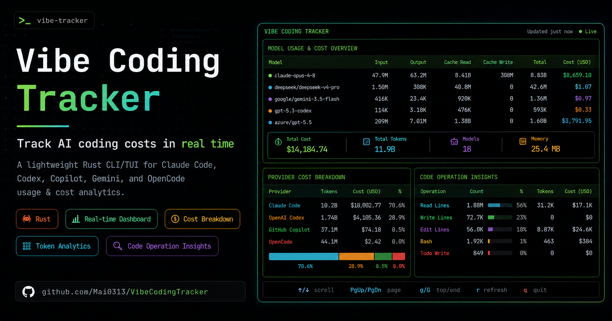

<div align="center" markdown="1">

# Vibe Coding Tracker — AI 程式設計助手使用量追蹤器

[](https://crates.io/crates/vct-cli) [](https://crates.io/crates/vct-cli) [](https://www.npmjs.com/package/vibe-coding-tracker) [](https://www.npmjs.com/package/vibe-coding-tracker) [](https://pypi.org/project/vibe_coding_tracker/) [](https://pypi.org/project/vibe-coding-tracker) [](https://www.rust-lang.org/) [](https://github.com/Mai0313/VibeCodingTracker/actions/workflows/test.yml) [](https://github.com/Mai0313/VibeCodingTracker/actions/workflows/code-quality-check.yml) [](https://github.com/Mai0313/VibeCodingTracker/tree/main?tab=License-1-ov-file) [](https://github.com/Mai0313/VibeCodingTracker) [](https://github.com/Mai0313/VibeCodingTracker/pulls)



</div>

**即時追蹤你的 AI 程式設計花費。** Vibe Coding Tracker 是一款以 Rust 打造的輕量、高效能 CLI 工具，能監控與分析你在 Claude Code、Codex、Copilot、Gemini、OpenCode、Cursor、Hermes、Grok、DeepSeek Harness 及 Antigravity 的使用狀況——提供詳細的費用明細、token 統計資料與程式碼操作分析，同時維持極低的記憶體使用量。

[English](README.md) | [繁體中文](README.zh-TW.md) | [简体中文](README.zh-CN.md)

> 注意：CLI 範例使用簡短別名 `vct`。如果你是透過 npm/pip/cargo 安裝，執行檔可能命名為 `vibe_coding_tracker` 或 `vct`。如有需要，請建立別名或在執行指令時將 `vct` 替換為完整名稱。

---

## 為什麼選擇 Vibe Coding Tracker？

### 掌握你的花費

不用再猜測 AI 程式設計工作階段花了多少錢。透過 [LiteLLM](https://github.com/BerriAI/litellm) 自動更新價格，取得**即時費用追蹤**。

### 超輕量

以 Rust 打造, 資源佔用極低. 互動式 TUI 儀表板完成首次刷新後通常維持在 **60 MB 左右的常駐記憶體**, 即使硬碟上有數千個 session 也一樣. `~/.vct/sessions/` 底下的 session 帳本讓每次執行都只需重新解析新增或變更的 source.

### 精美視覺化

選擇你偏好的檢視方式：

- **互動式儀表板**: 一個終端 app, 內含 Usage, Analysis, Quota 與 Settings 四個分頁, 可立即顯示 loading spinner, 支援背景 incremental refresh, 可捲動並可排序的 model 清單 (方向鍵, `o`), process 層級的 CPU/記憶體即時讀數, 以及 K/M/B 精簡數字格式
- **靜態報表**:專業的表格格式,適合撰寫文件
- **腳本友好**:純文字及 JSON 輸出,方便自動化處理
- **完整精度**:匯出精確費用供會計使用

### 零設定

自動偵測並處理 Claude Code、Codex、Copilot、Gemini、OpenCode、Cursor、Hermes、Grok、DeepSeek Harness 及 Antigravity 的日誌檔。不需要任何設定——直接執行就能分析。首次執行時會以合理的預設值建立 `~/.vct/config.toml`，日後若想微調行為即可編輯它（見 [設定](#%E8%A8%AD%E5%AE%9A)）。

### 豐富洞察

- 依模型與日期分類的 token 使用量
- 依 cache 類型（讀取 / 建立）的費用明細
- 檔案操作追蹤（編輯、讀取、寫入行數）
- 工具呼叫歷史（Bash、Edit、Read、Write、TodoWrite）
- 每個供應商的總計

---

## 主要功能

| 功能             | 說明                                                                                                 |
| ---------------- | ---------------------------------------------------------------------------------------------------- |
| **多供應商支援** | Claude Code、Codex、Copilot、Gemini、OpenCode、Cursor、Hermes、Grok、DeepSeek Harness 及 Antigravity |
| **智慧定價**     | 模糊模型比對 + 每日從 LiteLLM cache 更新                                                             |
| **4 種顯示模式** | 互動式 TUI、靜態表格、純文字及 JSON                                                                  |
| **雙重分析**     | Token / 費用統計（`usage`）+ 程式碼操作統計（`analysis`）                                            |
| **即時額度面板** | 即時顯示 Claude、Codex、Copilot、Cursor、Grok 與 Antigravity 的額度用量                              |
| **超輕量**       | TUI 常駐記憶體約 60 MB、精簡的 incremental scan, 以 Rust 打造                                        |
| **即時更新**     | 響應式 loading 與背景 refresh, 並突顯變更                                                            |

---

## 快速開始

### 安裝

選擇最適合你的安裝方式：

#### 方法一：透過 npm 安裝

**前置條件**：[Node.js](https://nodejs.org/) v22 或更高版本

選擇以下任一套件名稱（內容完全相同）：

```bash
# Main package
npm install -g vibe-coding-tracker

# Short alias with scope
npm install -g @mai0313/vct

# Full name with scope
npm install -g @mai0313/vibe-coding-tracker
```

#### 方法二：透過 PyPI 安裝

**前置條件**：Python 3.8 或更高版本

```bash
pip install vibe_coding_tracker
# Or with uv
uv pip install vibe_coding_tracker

# Run without installing, straight from PyPI (uv)
uvx vibe_coding_tracker usage
```

#### 方法三：透過 crates.io 安裝

使用 Cargo 從官方 Rust 套件倉庫安裝：

```bash
cargo install vct-cli
```

### 首次執行

```bash
# Open the interactive app on the Usage tab
vct

# Or run the binary built by Cargo/pip
vibe_coding_tracker

# Open it on the Analysis tab (code operations across all sessions)
vct analysis
```

---

## 指令指南

執行 `vct --help` 可列出所有指令，`vct <command> --help` 則會列出該指令的 flag。

不帶任何指令執行 `vct` 會開啟互動式介面，一個畫面有四個分頁：`1 Usage`、`2 Analysis`、`3 Quota` 與 `4 Settings`。`vct usage`、`vct analysis` 與 `vct quota` 會開啟同一個介面並停在各自的分頁，`--json`、`--text` 與 `--table` 則只輸出結果，不會開啟介面。沒有終端時（輸出被 pipe 或重新導向），單獨的 `vct` 會印出說明並以狀態碼 2 結束。

| 按鍵                | 動作                                                                      |
| ------------------- | ------------------------------------------------------------------------- |
| `1`-`4`             | 跳到對應的分頁                                                            |
| `Tab` / `Shift+Tab` | 下一個 / 上一個分頁（在 Settings 分頁，`Tab` 改為在它的兩個窗格之間切換） |
| `↑` / `↓`           | 移動選取的列                                                              |
| `o`                 | 切換排序欄位（Usage、Analysis）                                           |
| `t`                 | 切換時間範圍：day、week、month、all（Usage、Analysis）                    |
| `r`                 | 立即刷新（Usage、Analysis）                                               |
| `m`                 | 合併 / 拆開 provider 前綴，會存進設定檔（Usage）                          |
| `p`                 | 開啟 Provider Usage 面板，按 `Esc` 關閉（Usage）                          |
| `q` / `Esc`         | 離開                                                                      |

Quota 與 Settings 分頁不掃描任何 session。第一次切到 Usage 或 Analysis 時才開始該分頁的掃描，而且只有畫面上的分頁會依計時器刷新。分頁列右側顯示時間範圍，以及 vct 自己的記憶體與 CPU 用量。

時間範圍 flag（`usage` 與 `analysis` 共用，互斥，預設 `--all`；在互動式介面中則決定開啟時的範圍）：

| Flag          | 範圍                       |
| ------------- | -------------------------- |
| `--daily`     | 今天更新過的 session       |
| `--weekly`    | 本 ISO 週（週一 → 今天）   |
| `--monthly`   | 本自然月                   |
| `-a`, `--all` | 磁碟上所有 session（預設） |

---

## Usage 指令

**追蹤你在所有 AI 程式設計工作階段的花費。**

### 基本用法

```bash
# Open the app on the Usage tab (recommended)
vct usage

# Static table for reports
vct usage --table

# Plain text for scripts
vct usage --text

# JSON 輸出，每列都有 cost_usd；以其他 model 名稱計價時才會多出 matched_model 欄位
vct usage --json

# 透過 shell redirection 儲存富化 JSON
vct usage --json > report.json

# 時間範圍與輸出格式可自由組合
vct usage --weekly
vct usage --table --monthly
vct usage --json --daily

# 合併同一 model 在不同 provider 前綴下的多列
# (例如 openai/gpt-5.5 + azure/gpt-5.5 + gpt-5.5 -> 一列)
vct usage --table --merge-providers
```

> [!NOTE]
> `--table` 與 `--text` 的 model 列會依 cost 由小到大排序，所以花費最高的 model 會排在最後（在 `--table` 中緊鄰 `TOTAL` 列上方）；`--json` 的列則沒有固定順序。互動式介面預設依 cost 由大到小排序，按 `o` 可切換排序欄位：cost、total、input、output、cache read、cache write、model 名稱。表格標題右側會標出目前的排序（`cost ▼`）。互動式介面也會隱藏在所選範圍內用量為 0 的 model。

> [!TIP]
> 同一個 model 在不同 provider 前綴下路由時會顯示成多列（`openai/gpt-5.5`、`azure/gpt-5.5`、純 `gpt-5.5`）。`--merge-providers` 會把第一個 `/` 之後 base 名稱相同的列合併（`gpt-5.5` 與 `gpt-5.4` 這類版本不同的仍分開），並把它們已定價的 cost 相加。在 Usage 分頁按 `m` 可即時切換（這個選擇會存進 `~/.vct/config.toml`，所以下次啟動時會記住這個設定）;`--merge-providers` 則讓該分頁一打開就是合併狀態。`--json` 保持為逐一 model 的原始輸出。

### 預覽：Usage 分頁（`vct usage`）

```
 vct  1 Usage  2 Analysis  3 Quota  4 Settings                         range  day  week  month  all   61.8 MB · CPU 0.1%
┌ Models · $79.33 · 49.1M tokens · 3 models ─────────────────────────────────────────────────────────────────── cost ▼ ┐
│Model                              Input     Output    Cache Read  Cache Write Total     Cost (USD)   Share           █
│                                                                                                                      █
│claude-opus-4-8                        25.7K      179K       42.9M        496K     43.6M       $77.59  █████████ 88.8%█
│claude-haiku-4-5-20251001              5.57K     19.8K       5.20M       55.0K     5.28M        $1.34          █ 10.8%█
│gemini-3.1-pro-preview                  129K     10.3K       66.0K       1.70K      207K        $0.40             0.4%█
│                                                                                                                      █
│                                                                                                                      █
└──────────────────────────────────────────────────────────────────────────────────────────────────────────────────────┘
                                              Claude $78.93 · Gemini $0.40
┌ Claude ──────────────┐┌ Codex ───────────────┐┌ Copilot ─────────────┐┌ Cursor ────────LIMIT ┐┌ Grok ────────────────┐
│max 20x       just now││plus          just now││individual    just now││free          just now││SuperGrok     just now│
│5h    ▰▱▱▱▱  13% 1h42m││5h    ▰▰▱▱▱  33% 12m  ││prem  ▰▱▱▱▱   3% 24d0h││total ▰▰▰▰▰  94% 16d0h││week  ▰▰▱▱▱  38% 3d4h │
│7d    ▰▰▰▱▱  58% 1d23h││7d    ▰▰▱▱▱  36% 1h54m││reqs  ▰▱▱▱▱ 45/1500   ││auto  ▰▰▰▰▰ 100% 16d0h││ondmd $4.20/$50.00    │
│Fable ▰▰▰▰▱  79% 1d23h││credits 0 · +3 reset  ││                      ││api   ▰▰▰▱▱  44% 16d0h││balance $12.00        │
│bal - · $0.00 used    ││reset expires 17d0h   ││                      ││                      ││                      │
└──────────────────────┘└──────────────────────┘└──────────────────────┘└──────────────────────┘└──────────────────────┘
                ↑/↓ scroll  o sort  t range  m merge  p providers  r refresh  q quit  |  Star on GitHub
```

Usage 與 Analysis 分頁各自在第一次切到時開始掃描, 並繪製置中的 `Loading sessions...` spinner. Loading 期間仍可處理 `q`, Ctrl+C 與 resize event. 後續掃描會在 `Refreshing...` footer 下保留上一次成功的資料. 如果 refresh 失敗, 分頁會保留 last-known-good view, 並在下次排程或手動刷新時重試. 所選範圍內沒有任何 session 時, 會顯示空的表格.

### 預覽：表格與 JSON（`vct usage`）

`--table` 會以靜態報表印出相同的數字，並附上每個供應商的彙總；`--json` 則為每個 model 輸出一列富化資料（各自帶有 `cost_usd`），方便腳本處理。

```text
Token Usage Statistics

┌───────────────────────────┬─────────┬─────────┬─────────────┬─────────────┬──────────────┬────────────┐
│ Model                     ┆   Input ┆  Output ┆  Cache Read ┆ Cache Write ┆ Total Tokens ┆ Cost (USD) │
╞═══════════════════════════╪═════════╪═════════╪═════════════╪═════════════╪══════════════╪════════════╡
│ opencode/gemini-3.5-flash ┆  19,421 ┆     254 ┆           0 ┆           0 ┆       19,675 ┆      $0.03 │
│ gpt-5.5                   ┆ 242,227 ┆  16,229 ┆   2,406,912 ┆           0 ┆    2,665,368 ┆      $5.56 │
│ claude-opus-4-8           ┆ 401,937 ┆ 936,186 ┆ 138,099,926 ┆   6,057,836 ┆  145,495,885 ┆    $151.29 │
│ TOTAL                     ┆ 663,585 ┆ 952,669 ┆ 140,506,838 ┆   6,057,836 ┆  148,180,928 ┆    $156.88 │
└───────────────────────────┴─────────┴─────────┴─────────────┴─────────────┴──────────────┴────────────┘

Totals (by Provider)

┌───────────────┬─────────────┬─────────┐
│ Provider      ┆      Tokens ┆    Cost │
╞═══════════════╪═════════════╪═════════╡
│ Claude        ┆ 145,495,885 ┆ $151.29 │
│ Codex         ┆   2,665,368 ┆   $5.56 │
│ OpenCode      ┆      19,675 ┆   $0.03 │
│ All Providers ┆ 148,180,928 ┆ $156.88 │
└───────────────┴─────────────┴─────────┘
```

```json
// vct usage --json  (one model shown; rows come in no fixed order)
[
  {
    "cost_usd": 151.29,
    "model": "claude-opus-4-8",
    "usage": {
      "cache_creation": {
        "ephemeral_1h_input_tokens": 0,
        "ephemeral_5m_input_tokens": 6057836
      },
      "cache_creation_input_tokens": 6057836,
      "cache_read_input_tokens": 138099926,
      "input_tokens": 401937,
      "output_tokens": 936186,
      "reasoning_output_tokens": 0,
      "total_tokens": 145495885
    }
  }
]
```

無論來源 provider 為何，每一列都會輸出相同的扁平 token 欄位。有幾個 key 只在該列有對應數值時才會出現：`cache_creation` 把 cache 寫入拆成 5 分鐘與 1 小時 TTL 兩部分，`server_tool_use` 記錄 Claude 的 web search 次數，`above_tier` 記錄 prompt 超過長 context 計價級距的請求所用的 token，實際用掉 tool token 的 Gemini 列則會帶 `tool_tokens`，LiteLLM 沒有對應費率，只計入 `total_tokens`。

### 掃描範圍

此工具會自動掃描以下目錄：

- `~/.claude/projects/**/*.jsonl`（Claude Code，遞迴包含 subagent 日誌）
- `~/.codex/sessions/**/*.jsonl`（Codex，遞迴包含每日子目錄），以及 `~/.codex/archived_sessions/*.jsonl`——封存工作階段時 Codex 會把日誌移進這個扁平目錄（同時存在於兩處的工作階段只會計入一次）
- `~/.copilot/session-state/<sessionId>/events.jsonl`（Copilot CLI）
- `~/.gemini/tmp/<project_hash>/chats/*.jsonl`（Gemini CLI）
- `~/.local/share/opencode/opencode.db`（OpenCode，SQLite 資料庫；遵循 `$XDG_DATA_HOME`）
- `~/.cursor/chats/*/*/store.db`（Cursor，SQLite 對話庫，用於 `analysis`，並產生與其他 provider 一致的本地 `usage` 估算）
- `~/.hermes/state.db`（Hermes，SQLite 資料庫，遵循 `$HERMES_HOME`；僅 `usage`）
- `$GROK_HOME/sessions/*/*/signals.json`（Grok CLI，預設使用 `~/.grok`；同層的 `updates.jsonl` 提供 `analysis` 資料）
- `$DSH_HOME/sessions/*/*/session.jsonl.zstd`（DeepSeek Harness，預設使用 `~/.dsh`；若該 root 設定為 `compression = "none"` 則寫成 `session.jsonl`，兩種都會讀取）
- `~/.gemini/{antigravity-cli,antigravity,jetski}/brain/*/.system_generated/logs/transcript_full.jsonl`（Antigravity：`agy` CLI、Desktop app 與 Jetski 合併算成同一個 provider；每段對話的 model 取自同層的 `conversations/<id>.db`）

Grok 的 `usage` 是單一當下的本地 context 估算：vct 會把 `signals.json` 的 `contextTokensUsed` 記為 cache-read token，並以該 model 的 cache-read 費率估算費用。這不是累計的 billed usage。`analysis` 會從同層的 `updates.jsonl` 還原已完成的 Read / Write / Edit / Bash / TodoWrite 操作。想知道實際計費的額度用量，請參考下方的 Grok 額度面板。

對於非互動式 `usage` 與 `analysis` 掃描, 如果所有找到的 source 都失敗, vct 會回傳錯誤. 如果只有部分 source 失敗, vct 會保留成功的結果, 並向 stderr 印出一則診斷摘要. TUI 則保持 best-effort, 並保留上一次成功的 payload.

### Session 帳本

每次 `usage` 與 `analysis` 掃描都會讀寫 `~/.vct/sessions/` 底下的 session 帳本（每個助手一個 `<provider>.json`）。沒有變動的 session 不會被解析第二次，所以一次性執行與儀表板的首次載入只需處理有變動的部分。更重要的是，來源消失後 session 仍會留在帳本裡：當助手清掉自己的歷史（Claude Code 預設只保留 30 天），或整個 session 目錄（例如 `~/.claude/projects`）被刪除時，所有總計仍會把它們算進去，非互動式執行也會印出一行說明有多少 session 來自帳本。繼續對話的 session 會在紀錄檔變動時重新讀取。帳本只保存每日的 token 數與工具計數（沿用各 provider 自己的欄位形狀），不存對話內容也不存價格，而且 vct 永遠不會刪除它：讀不了的檔案會改名放在旁邊，較新版 vct 寫的檔案則原封不動。想從磁碟現況重新開始，刪掉這個目錄即可。`vct analysis --json` 與 `vct analysis FILE` 會完整解析檔案，不使用帳本。

### 其他機器

`vct usage` 與 `vct analysis` 可以把其他機器的 session 加進這台的總計。在 [`config.toml`](#%E8%A8%AD%E5%AE%9A) 裡把它們列為 ssh 目標：

```toml
[remotes]
hosts = ["devbox", "wei@laptop"]
```

vct 會透過 ssh 在每台主機上執行 `vct ledger export`，並把回傳的結果併入所有總計。經過連線的只有那台機器的帳本，也就是每日的 token 數與工具計數：對話內容、資料庫與憑證都留在原地。每台主機都要裝有支援 `ledger export` 的 vct，並且能不經提示登入，因為 vct 以批次模式執行 `ssh`：金鑰、agent，或 `~/.ssh/config` 為該名稱設定的任何方式皆可。

- 一次性指令（`--json`、`--text`、`--table`）會先抓取，每台主機最多等 30 秒。主機第一次匯出要解析完整歷史，可能超過這個時間；它在那邊仍會跑完，所以下一次執行就拿得到。儀表板則每 `refresh_interval` 秒（預設 300）在背景抓取，從不等待。
- 連不上的主機會繼續顯示上次抓到的資料，一次性指令在 stderr 印出警告，儀表板則記在 log。把主機從 `hosts` 拿掉就會移除它的資料。
- 非互動式 ssh 的 `PATH` 很精簡，所以 vct 會依序在 `PATH`、`~/.local/bin`、`~/.cargo/bin` 與 `~/.nvm` 底下找遠端的執行檔。裝在別處時，把 `command` 設成啟動它的方式。
- 兩台機器都有的 session（例如共用家目錄）只算一次。日期是各機器自己的本地日期。總計是合併後的數字，沒有分機器的明細。
- `vct analysis --json`、`vct analysis FILE` 與額度面板只看本機。

### 即時額度面板

`vct usage` 會**在儀表板中直接顯示 Claude Code、Codex、GitHub Copilot、Cursor、Grok 與 Antigravity 的即時額度用量——完全零設定。** 不需要 status-line hook，也不需要手動輸入憑證：vct 會讀取各 provider 自己的 OAuth 憑證，在背景執行緒呼叫其用量 API（Antigravity 則是詢問 `agy` CLI），並在你工作時讓面板保持最新。每個進度條都是**已用**百分比，所以進度條滿格代表該額度週期已用盡，而不是還沒開始用。（想要更清爽的儀表板嗎？在 [`config.toml`](#%E8%A8%AD%E5%AE%9A) 中精簡 `[usage.quota]` 下的 `panels`,或設為 `[]` 隱藏所有額度卡片。表格下方那行各 provider 成本是本機掃描資料而不是額度面板,所以不受這裡的設定影響。）

```
┌ Claude ──────────────┐┌ Codex ───────────────┐┌ Copilot ─────────────┐┌ Cursor ────────LIMIT ┐┌ Grok ────────────────┐
│max 20x       just now││plus          just now││individual    just now││free          just now││SuperGrok     just now│
│5h    ▰▱▱▱▱  13% 1h42m││5h    ▰▰▱▱▱  33% 12m  ││prem  ▰▱▱▱▱   3% 24d0h││total ▰▰▰▰▰  94% 16d0h││week  ▰▰▱▱▱  38% 3d4h │
│7d    ▰▰▰▱▱  58% 1d23h││7d    ▰▰▱▱▱  36% 1h54m││reqs  ▰▱▱▱▱ 45/1500   ││auto  ▰▰▰▰▰ 100% 16d0h││ondmd $4.20/$50.00    │
│Fable ▰▰▰▰▱  79% 1d23h││credits 0 · +3 reset  ││                      ││api   ▰▰▰▱▱  44% 16d0h││balance $12.00        │
│bal - · $0.00 used    ││reset expires 17d0h   ││                      ││                      ││                      │
└──────────────────────┘└──────────────────────┘└──────────────────────┘└──────────────────────┘└──────────────────────┘
┌ Antigravity ──────+2 ┐
│-             just now│
│Gemini Models         │
│5h     ▰▰▱▱▱  23%     │
│weekly ▰▱▱▱▱   8%     │
│Claude and GPT models │
└──────────────────────┘
```

- **Claude** — 方案類型、5 小時、每週以及單模型每週用量，來自官方 OAuth 用量 API（`GET /api/oauth/usage`），從 `~/.claude/.credentials.json` 讀取，並顯示額度餘額。約每分鐘輪詢一次以避開該端點的速率限制；觸及上限時標題會出現紅色 `LIMIT` 標記。單模型每週那一行屬於盡力而為，未回傳該範圍時就自動隱藏。
- **Codex** — 方案類型、可用的 5 小時和每週用量週期、額度餘額以及已取得的可用 reset credit 中最早的到期時間，使用 `~/.codex/auth.json` 從 ChatGPT 後端（`wham/usage` + `wham/rate-limit-reset-credits`）取得（在適用時顯示大致剩餘訊息數 / 消費上限）；API 無法使用時回退到 Codex 工作階段紀錄中最新的 `rate_limits`（標題顯示 `Codex` 或 `Codex (session)`）。
- **Copilot** — 方案類型以及你的 premium 請求額度，以兩個進度條呈現：已用百分比，以及已用 / 總量請求數（例如 `45/1500`），來自 GitHub 的 Copilot API（`GET /copilot_internal/user`），從 `~/.copilot/config.json` 讀取。該請求會模擬 Copilot CLI。token 為長期有效，因此不需要刷新；遇到 `401` / `403` 時會顯示 `run: copilot login` 提示。
- **Cursor** — 方案類型、total / auto / API **已用**百分比，以及按需消費，來自 cursor.com（`GET /api/usage-summary`），使用 `~/.config/cursor/auth.json` 中的 session token。
- **Grok** — 方案類型以及目前每週或每月週期的內含額度用量，來自 Grok CLI 自己的計費端點（`GET /v1/billing?format=credits`），從 `~/.grok/auth.json` 讀取。預付餘額只有在不為零時才會顯示；按量計費的消費則在你有過消費、或設定了上限之後才會顯示。該請求會模擬 Grok CLI；遇到 `401` / `403` 時會顯示 `run: grok login` 提示。
- **Antigravity** — 每個共用模型池的額度（agy 的是 Gemini 以及 Claude / GPT，各有 5 小時與每週額度），來自 `agy` CLI 自己的 `/usage` 指令（`agy -p /usage --output-format json`）。卡片直接用 agy 給的模型池名稱，每個額度則以 agy 的時間窗原樣標示（`5h` 排最前，接著是 `weekly`）；卡片放不下所有模型池時，其餘的以 `+N` 標出。`/usage` 不提供方案名稱，所以第一行只顯示資料的新舊。vct 會執行 `PATH` 上的 `agy`，找不到時改找 agy 的安裝位置（`~/.local/bin/agy`、`%LOCALAPPDATA%\agy\bin\agy.exe`），或 Google 內部版本 Jetski 的位置（gLinux 上的 `/google/bin/releases/jetski-devs/tools/cli`、macOS 上的 `/usr/local/bin/jetski`）；尚未登入的 agy 不會擋掉 Jetski。agy 會自行維持登入狀態，因此 vct 只檢查 `~/.gemini/antigravity-cli/antigravity-oauth-token` 是否存在，從不讀取或寫入它；Jetski 有自己的登入方式，找到它就夠了。每次輪詢都會啟動一次 agy（需要幾秒、約 260 MB），所以這張卡片最多每 5 分鐘更新一次。agy 無法登入時，卡片會顯示 `run: agy acp --login` 提示，而且在該檔案變動之前，儀表板不會再執行 agy。

**自動刷新 token。** 對 Claude、Codex 和 Grok，當 token 接近過期或被拒絕時，vct 會刷新它並把新的 token 寫回該 provider 自己的憑證檔案（採用該 CLI 的原始格式）。寫入 Grok 的憑證檔案時，會保留該檔案中其他所有的登入資訊。如果刷新失敗，面板會顯示 `run: <provider> auth login` 提示，而不會直接中斷。Copilot（長期有效的 token）和 Cursor（由其自身用戶端保持最新）為唯讀——vct 從不寫入它們的憑證檔案。Antigravity 的 token 屬於 agy，每當 vct 向它詢問 `/usage` 時由 agy 自行刷新。

只有在某個 provider 的憑證存在時，才會顯示對應的面板。面板排在一個統一網格上：一列放得下幾張就放幾張，放不下的自動折到下一列。當終端高度不足以留給網格時，它會收成一行摘要，顯示放得下的 gauge，並把其餘的記成 `+N more → 3`；按 `3` 切到 [Quota 分頁](#quota-%E5%88%86%E9%A0%81)，整個畫面都留給卡片，按 `p` 開啟 Provider Usage 面板，裡面有各 provider 的 token 數與佔比。額度面板僅在互動式 TUI 中顯示；`--table`、`--text`、`--json` 不受影響。

> **平台說明：** 在 macOS 上，Claude Code 會把 OAuth 憑證儲存在系統 Keychain 中，而不是 `~/.claude/.credentials.json`，因此在 macOS 上不會顯示 Claude 面板。agy 在 macOS 上同樣把登入資訊存在 Keychain，所以 macOS 上只有 Google 內部版本 Jetski 會顯示 Antigravity 面板。Cursor 的 `~/.config/cursor` 憑證路徑偏向 Linux。

---

## Analysis 指令

**深入分析程式碼操作——精確掌握你的 AI 助手做了哪些事。**

請參考 [`tests/fixtures/sessions/`](tests/fixtures/sessions/) 目錄，裡面有四種 JSONL provider 的範例輸入與對應的 JSON 輸出，以及 [`tests/fixtures/sessions/grok/`](tests/fixtures/sessions/grok/) 下的 Grok session fixture 、[`tests/fixtures/sessions/dsh/`](tests/fixtures/sessions/dsh/) 下的 DeepSeek Harness session fixture，與 [`tests/fixtures/sessions/antigravity/`](tests/fixtures/sessions/antigravity/) 下的 Antigravity fixture。

### 基本用法

```bash
# Open the app on the Analysis tab, all sessions (default)
vct analysis

# Static table output with per-provider totals
vct analysis --table

# 純文字輸出，方便腳本處理
vct analysis --text

# 輸出所有 session 的完整 parser 結果
vct analysis --json

# 分析單一對話檔案並輸出 JSON
vct analysis ~/.claude/projects/session.jsonl

# 只摘要這個對話檔案
vct analysis ~/.claude/projects/session.jsonl --table

# 透過 shell redirection 儲存完整 JSON
vct analysis --json > report.json
vct analysis ~/.claude/projects/session.jsonl > session-analysis.json

# 時間範圍與輸出格式可自由組合
vct analysis --weekly
vct analysis --table --monthly
vct analysis --json --daily
vct analysis --json --daily > today.json
```

### 預覽：Analysis 分頁（`vct analysis`）

```
 vct  1 Usage  2 Analysis  3 Quota  4 Settings                         range  day  week  month  all   61.9 MB · CPU 0.1%
┌ Models · 135K lines · 1.80K tool calls · 3 models ────────────────────────────────────────────────────────── lines ▼ ┐
│Model                                   Edit Lines  Read Lines  Write Lines Bash    Edit    Read    TodoWrite  Write  █
│                                                                                                                      █
│claude-opus-4-8                               12.4K       88.1K       9.02K     412     231     604         96      88█
│gemini-3.1-pro-preview                        2.10K       14.8K       1.62K      84      44     112         16      15█
│claude-haiku-4-5-20251001                       840       5.40K         610      31      16      42          6       5█
│                                                                                                                      █
└──────────────────────────────────────────────────────────────────────────────────────────────────────────────────────┘
┌ Providers ───────────────────────────────────────────────────────────────────────────────────────────────────────────┐
│Provider                 Edit Lines  Read Lines  Write Lines  Bash     Edit     Read     TodoWrite   Write    Days    │
│                                                                                                                      │
│Claude                   13.2K       93.5K       9.63K        443      247      646      102         93       12      │
│Gemini                   2.10K       14.8K       1.62K        84       44       112      16          15       3       │
└──────────────────────────────────────────────────────────────────────────────────────────────────────────────────────┘
                           ↑/↓ scroll  o sort  t range  r refresh  q quit  |  Star on GitHub
```

表格預設依總行數由大到小排序；按 `o` 可切換排序欄位：lines、edit lines、read lines、write lines、tool calls、model 名稱。

### 預覽：表格與 JSON（`vct analysis`）

`--table` 會顯示各 model 的明細, 並附上各 provider 的摘要, 包含 Active Days 欄位. `--text` 與 `--table` 都是相同 normalized parser records 的精簡 projection. `--json` 會保留完整 records, 包括每次操作的 details 與 token usage. 未提供 `<FILE>` 時, 外層陣列中的每個元素都是一個 session 的 `CodeAnalysis` object. 提供 `<FILE>` 時, stdout 只會輸出該 object, shape 與 [`tests/fixtures/sessions/`](tests/fixtures/sessions/) 中對應的結果相同.

```text
Analysis Statistics

┌─────────────────┬────────────┬────────────┬─────────────┬──────┬──────┬──────┬───────────┬───────┐
│ Model           ┆ Edit Lines ┆ Read Lines ┆ Write Lines ┆ Bash ┆ Edit ┆ Read ┆ TodoWrite ┆ Write │
╞═════════════════╪════════════╪════════════╪═════════════╪══════╪══════╪══════╪═══════════╪═══════╡
│ gpt-5.5         ┆          0 ┆      3,087 ┆           0 ┆   25 ┆    0 ┆   10 ┆         0 ┆     0 │
│ claude-opus-4-8 ┆      1,493 ┆     15,564 ┆         970 ┆  123 ┆  134 ┆  144 ┆         0 ┆    12 │
│ TOTAL           ┆      1,493 ┆     18,651 ┆         970 ┆  148 ┆  134 ┆  154 ┆         0 ┆    12 │
└─────────────────┴────────────┴────────────┴─────────────┴──────┴──────┴──────┴───────────┴───────┘
```

```jsonc
// vct analysis --json  (one abbreviated session shown)
[
  {
    "user": "alice",
    "extensionName": "Claude-Code",
    "insightsVersion": "...",
    "machineId": "...",
    "records": [
      {
        "totalUniqueFiles": 3,
        "totalReadLines": 120,
        "readFileDetails": [
          {
            "filePath": "/repo/src/main.rs",
            "lineCount": 120,
            "characterCount": 4102,
            "timestamp": 1783872000000
          }
        ],
        "toolCallCounts": { "Bash": 1, "Edit": 0, "Read": 1, "TodoWrite": 0, "Write": 0 },
        "conversationUsage": { "claude-opus-4-8": { "input_tokens": 42, "output_tokens": 18 } }
      }
    ]
  }
]
```

> [!WARNING]
> 完整 analysis JSON 可能很大, 也可能包含 source text, edit body, shell command, absolute path, repository URL, user name, machine identifier 與 token metadata. 分享前請先檢查內容.

Batch analysis 會讀取 Provider 的即時資料. 如果 assistant 在掃描期間繼續寫入 session, 後續執行可能合理地包含更新資料. 未變動的 input 會產生固定順序的輸出.

如果找到的 source 全部讀取失敗或使用無法辨識的 schema, 非互動式 analysis 會回傳 error. 如果只有部分 source 失敗, 成功結果會保留, warning 會寫入 stderr.

`analysis FILE` 對單一檔案內格式錯誤或不受支援的 record 採用相同行為: 在 stdout 保留已解析的 JSON/text/table 輸出, 並將一般性的 skipped-record warning 寫入 stderr.

Codex code mode session 會提供已完成的 JavaScript `exec` cell, 但沒有 nested tool 的結構化 trace. VCT 會將該 cell 計為一次 Bash call, 並在完整 JSON 中保留 source, 但不會猜測 nested Read/Edit/Write operation.

---

## Update 指令

**自動讓受支援的直接安裝維持最新版本.**

vct 啟動時最多每天 UTC 日期檢查一次新版. 只有透過官方 `scripts/install.sh` 或 `scripts/install.ps1` 安裝, 且帶有 `.vct-managed` marker 的執行檔, 才會下載並套用新版. 檢查, 下載與替換都不會印到 stdout 或 stderr. 網路失敗, rate limit, 唯讀目錄或另一個 vct process 正在執行時, 目前指令仍會照常繼續, 原因只會寫入 diagnostic log. `VCT_OFFLINE=1` 會完全略過檢查.

Unix 套用更新後, vct 會用新版 binary 重新執行目前指令. Windows 則會讓目前指令結束, 再由 helper 套用替換. 自動流程絕不會修改透過 cargo, npm, PyPI, distro package 安裝的版本, 或沒有 marker 的手動與 development build. 請透過對應 package manager 更新. 既有的直接安裝只要再執行一次目前的官方 installer, 就會建立 marker 並啟用自動更新.

在 `~/.vct/config.toml` 設定 `general.auto_update = false` 可關閉啟動檢查與自動更新. 明確執行的 `vct update` 會保留原有的手動行為. `VCT_OFFLINE=1` 對它同樣有效: `--check`, 互動式確認與 `--force` 都會直接返回, 不會連線到 GitHub.

### 基本用法

```bash
# Check for updates
vct update --check

# Interactive update with confirmation
vct update

# Force update — always downloads latest version
vct update --force
```

### 預覽（`vct update --check`）

```
Current version: v1.3.0
Checking for latest release...
Latest version: v1.3.0 — you are up to date!
```

---

## Version 指令

檢視內建的建置資訊（binary version、Rust toolchain、Cargo version）：

```bash
vct version          # 彩色表格
vct version --text   # 每行一個欄位，適合腳本
vct version --json   # 機器可讀的 JSON
```

```text
┌───────────────┬──────────┐
│ Version       ┆ 1.3.0    │
│ Rust Version  ┆ 1.96.0   │
│ Cargo Version ┆ 1.96.0   │
└───────────────┴──────────┘
```

---

## Quota 指令

**全螢幕的即時 quota 面板，或某個供應商的原始 quota/usage API 回應。**

### Quota 分頁

`vct quota` 會開啟互動式介面並停在 Quota 分頁。它顯示與 Usage 分頁相同的 quota 卡片，進度條更寬，終端放得下幾張就顯示幾張（其餘的以 `+N hidden, enlarge the terminal` 標出數量）。它不掃描任何 session，所以立即開啟，也夠輕量，適合放在閒置的 pane 裡常駐。它沿用相同的設定：[`config.toml`](#%E8%A8%AD%E5%AE%9A) 中 `[usage.quota]` 底下的 `panels` 與 `refresh_interval`。

```bash
vct quota
```

```
 vct  1 Usage  2 Analysis  3 Quota  4 Settings                31.6 MB · CPU 0.0%

┌ Claude ──────────────────────────────┐┌ Codex ───────────────────────────────┐
│max 5x                        just now││plus                          just now│
│5h    ▰▰▰▰▰▰▱▱▱▱▱▱▱▱▱▱▱  30%  ↻ 2h18m ││5h    ▱▱▱▱▱▱▱▱▱▱▱▱▱▱▱▱▱   0%  ↻ 4h59m │
│7d    ▰▰▰▰▰▱▱▱▱▱▱▱▱▱▱▱▱  28%  ↻ 6d3h  ││7d    ▰▱▱▱▱▱▱▱▱▱▱▱▱▱▱▱▱   1%  ↻ 6d8h  │
│Fable ▰▰▰▱▱▱▱▱▱▱▱▱▱▱▱▱▱  14%  ↻ 6d3h  ││credits 0 · +3 reset                  │
│bal - · $0.00 used                    ││reset expires 17d11h                  │
└──────────────────────────────────────┘└──────────────────────────────────────┘

                                     q quit
```

> `vct monitor` 與隱藏別名 `vct fetch` 已移除。要看卡片請用 `vct quota`，要看原始回應請用 `vct quota <provider>`。

### 原始回應（`vct quota <provider>`）

帶上供應商時，`vct quota` 會印出該供應商的原始回應，不解析、不彙整。它對 `usage` 面板使用的同一個 quota 端點（Claude / Codex / Copilot / Cursor / Grok）發一次請求，直接印出原始 body，方便你檢視 API 的實際結構或確認憑證是否正常。它讀取各供應商已儲存的憑證，而且**不會**刷新 token：token 過期時，請用對應供應商自己的 CLI 重新登入（`claude` / `codex` / `copilot` / `cursor-agent` / `grok`）。`vct quota antigravity` 則是執行一次 `agy -p /usage --output-format json`（或用儀表板相同的方式找到的 Jetski）並印出它的輸出；agy 會在執行時自行刷新 token。

`--json`、`--text` 與 `--table` 印出的是單一供應商的回應，所以不帶供應商的 `vct quota --json` 會回報錯誤。

```bash
# 原始 JSON（預設）
vct quota claude
vct quota codex
vct quota copilot
vct quota cursor
vct quota grok
vct quota antigravity

# 攤平成純文字
vct quota codex --text

# 攤平成 key/value 表格
vct quota copilot --table
```

> [!NOTE]
> 回應 body 會原樣印到 stdout。遇到 HTTP 錯誤時仍會印出 body 並以非零狀態結束；401/403 會在 stderr 額外印出 `run: <cli> login` 提示。agy 執行失敗時也一樣，若是 agy 無法登入，還會附上 `run: agy acp --login` 提示。

---

## 設定

vct 會把使用者設定存放在 `~/.vct/config.toml`。這個檔案會在**首次執行時以預設值自動建立**，所以你完全不必手動撰寫，只有想更改某個預設值時才需要編輯它。它由 vct 的型別化設定產生，並在第一行帶有 `#:schema` 指令，因此支援 schema 的 TOML 編輯器（taplo / VS Code 的 "Even Better TOML"）會提供自動補全與驗證。你也可以用 `vct config schema` 自行印出該 schema。由舊版 vct 產生的檔案會在下次被 vct 讀取時就地升級到目前的版面(也可用 `vct config migrate` 手動觸發),因此升級後絕不會停留在過時的格式上。這個升級也會把你的檔案寫入之後才推出的額度面板補上——但只補一次。你再次移除那個名稱後它就會一直保持移除，而你先前已經拿掉的面板也絕不會被加回來。

執行 `vct config show` 即可印出這個檔案，檔案內的註解說明了每一項設定。

> [!NOTE]
> Cursor 的 `usage` 是從對話庫產生的**本地估算**，因此行為與 Claude Code / Codex / Copilot / Gemini 一致（全都是從本地 session 檔案計算），而且不需要連網。這個估算會低估 Cursor 的真實花費，因為其中有很大一部分是以 Cursor 內部的 model 名稱計費，而本地資料無法為這些名稱定價，所以請把 Cursor 的費用視為概估值。

> [!NOTE]
> vct 會把診斷訊息寫入 `~/.vct/logs/vct-YYYY-MM-DD.log`（純文字，只寫檔案，絕不顯示在儀表板上）。健康運行時保持安靜（預設等級 `warn`），而且檔案是延遲建立的，所以一次正常執行不會留下任何檔案。當額度抓取失敗或某個 session 被略過時，原因就記錄在這裡——需要完整細節時把 `logging.level` 調到 `debug`。

### Settings 分頁

在互動式介面中按 `4`（或用 `Tab` 切過去），就能以表單編輯 `config.toml` 的每一項設定：左邊是區段，右邊是該區段的欄位，下方則是目前欄位的說明、設定鍵與預設值。

```
 vct  1 Usage  2 Analysis  3 Quota  4 Settings                                                        31.8 MB · CPU 0.0%
┌ Sections ──────┐┌ Usage ─────────────────────────────────────────────────────────────────────────────────────────────┐
│ General        ││ Merge models across providers                                                               [x] on │
│ Usage          ││ Redraw interval                                                                           ‹ 10 s › │
│ Analysis       ││ Quota panel: Claude                                                                         [x] on │
│ Providers      ││ Quota panel: Codex                                                                          [x] on │
│ Remotes        ││ Quota panel: Copilot                                                                        [x] on │
│ Performance    ││ Quota panel: Cursor                                                                         [x] on │
│ Logging        ││ Quota panel: Grok                                                                           [x] on │
└────────────────┘└────────────────────────────────────────────────────────────────────────────────────────────────────┘
┌ Quota panel: Claude · usage.quota.panels ─────────────────────────────────────────────────────────── default: [x] on ┐
│Which live quota panels to show in the app, by provider name. An empty list hides every quota card.                   │
└──────────────────────────────────────────────────────────────────────────────────────────────────────────────────────┘
                       ↑↓ move  ←→ change  ⏎ edit  tab pane  x reset  e editor  1-4 view  q quit
```

- `↑` / `↓` 移動，`Tab` 切換窗格，`←` / `→` 變更數值（開關、增減數字、切換選項），`x` 把欄位重設為預設值，`e` 用 `$VISUAL` / `$EDITOR` 開啟設定檔，編輯器結束後重新載入。
- `Enter` 開啟編輯器：可挑選的清單、數字或文字輸入，或遠端主機清單（`a` 新增、`Enter` 編輯、`d` 刪除）。
- 每次變更都會立即寫入檔案，並保留檔案裡的註解。
- 合併、刷新間隔、quota 面板、quota 輪詢間隔與 provider 開關的變更會直接反映在執行中的介面（quota 面板則在離開 Settings 分頁時生效）。預設時間範圍、自動更新、掃描執行緒數、logging 與 remotes 要到下次啟動才生效，表單會在這些欄位上標明。

手動編輯檔案與下方的 `vct config` 指令仍然可用。

### 管理設定檔

```bash
# 印出設定檔路徑
vct config path

# 印出目前的設定
vct config show

# 用 $VISUAL / $EDITOR 開啟檔案（找不到時回退到 vi / notepad）
vct config edit

# 印出 JSON schema（可用以下指令重新產生：vct config schema > vct.schema.json）
vct config schema

# 就地把舊格式檔案升級到目前的版面
vct config migrate
```

---

## 智慧定價系統

### 運作方式

1. **自動更新**: 每個 UTC 日期從 [LiteLLM](https://github.com/BerriAI/litellm) 取得一次最新價格
2. **確定性比對**: 即使 model 名稱含有版本或 provider 前綴, 也會選擇最具體的配對
3. **失敗保護**: 取得失敗不會覆蓋有效 cache, vct 會保留舊 map, 並在五分鐘 backoff 後才再次嘗試

### 模型比對

**優先順序**：

1. **完全比對**：`claude-sonnet-4` → `claude-sonnet-4`
2. **正規化比對**：`claude-sonnet-4-20250514` → `claude-sonnet-4`
3. **子字串比對**：`custom-gpt-4` → `gpt-4`
4. **模糊比對**：使用 Jaro-Winkler 相似度（70% 門檻值）
5. **備援方案**：若無法配對則顯示 $0.00

泛用的佔位名稱（例如 cursor-agent 在 auto 模式寫入的 `default`）與過短的名稱不會進行子字串或模糊比對——寧可不計價，也不撿相似名稱的價格。

### 費用細節

- **Context tier 以單一 request 計**：LiteLLM 的「above Nk tokens」費率（如 GPT-5.x 超過 272k、Gemini 超過 200k）與 Qwen / doubao 的用量級距同樣只套用在自身 prompt context 超過分界的那些 request 上，不會套用到整次掃描的 token 總和。每個 request 會落在自身 context 實際到達的那一級費率上，因此一個分成四級的 model 對真的到達最高級的 request 就以最高級計價。沒有 per-request 粒度的 provider（以及離線掃描）一律以最低一級的費率計價，因此這類 model 的費用是下界。
- **不只 token**：Claude 的網頁搜尋工具呼叫（`server_tool_use.web_search_requests`）會在 token 費用之外，按每次查詢計費；其他所有 model 的每次查詢費用皆為 $0。
- **OpenCode**：只有在 LiteLLM **完全比對**成功時，才會依 token 為新型 model 計價；若沒有完全比對，vct 會採信該 assistant 訊息本身儲存的費用，而不是從名稱相近的 model 去猜測。
- **Hermes**：與 OpenCode 相同，LiteLLM **完全比對**成功時依 token 計價，否則使用 Hermes 本身儲存的費用。
- **DeepSeek Harness**：`dsh` 本身不記錄任何費用，因此一律經由與其他 file-based provider 相同的查找鏈依 LiteLLM 計價，沒有 OpenCode 或 Hermes 那樣的 stored cost 兜底。它會路由到部署方設定的任意 provider，因此部署自訂的 model 名稱很常見；LiteLLM 完全比對不到時費用為 $0。
- **Antigravity**：和其他 file-based provider 一樣依 LiteLLM 計價，model 取自每個 request 的 generation 紀錄。Compaction request 沒有記錄 model，其 token 依當下正在使用的 model 計價。
- **Grok**：只會把 `contextTokensUsed` 當成 cache-read token 計價（若該 model 沒有公布 cache-read 費率則改用 input 費率）；這是單一當下的本地 context 估算，不是累計的 billed usage。

---

## 開發

開發環境設定、從原始碼建置、測試、程式碼品質、commit 規範，以及發佈與打包說明，都在 [CONTRIBUTING.md](./.github/CONTRIBUTING.md)。
